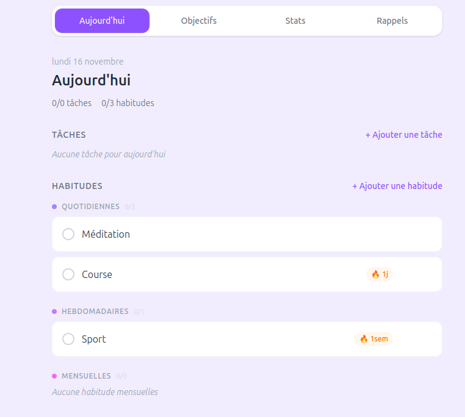

<div id="top" align="center">

# Goals Tracker

Suivi des tâches du jour, des habitudes et des objectifs long terme, dans une seule interface.

[](https://tracker.anatoledebus.com)




</div>

## Sommaire

- [Pourquoi ce projet](#pourquoi-ce-projet)
- [Fonctionnalités](#fonctionnalités)
- [Utilisation](#utilisation)
- [Lancer le projet en local](#lancer-le-projet-en-local)
- [Stack technique](#stack-technique)
- [Structure du projet](#structure-du-projet)
- [Roadmap](#roadmap)

## Pourquoi ce projet

Projet personnel né de deux envies : apprendre TypeScript sur un cas réel, et remplacer les
trois applications que j'utilisais séparément (todo list, habit tracker, notes d'objectifs) par
un outil léger qui réunit tout.

Il couvre la chaîne complète : modélisation des données, logique métier, interface,
statistiques, authentification et déploiement.

## Fonctionnalités

| | |
| --- | --- |
| **Tâches du jour** | Ajout, complétion et suppression. Une tâche cochée disparaît le lendemain. |
| **Habitudes** | Fréquence quotidienne, hebdomadaire ou mensuelle, avec streak en cours et meilleur streak. |
| **Objectifs** | Découpage en étapes, échéance, description et barre de progression automatique. |
| **Statistiques** | Complétion des 14 derniers jours, historique par habitude (14 jours, 12 semaines ou 12 mois), progression des objectifs. |
| **Rappels** | Notification web à l'heure choisie pour chaque habitude. |
| **Compte** | Inscription par email, données synchronisées entre appareils via Supabase. |

## Utilisation

Crée un compte avec ton email et un mot de passe : tes données te suivent sur tous tes appareils.

- **Aujourd'hui** : coche tes tâches et tes habitudes. Survole un élément (appui long sur
  mobile) pour le modifier ou le supprimer.
- **Objectifs** : crée un objectif, ajoute ses étapes, la progression se calcule seule.
- **Stats** : suis la régularité de chaque habitude et l'avancement de tes objectifs.
- **Rappels** : choisis une heure par habitude. Les notifications partent tant que l'onglet
  reste ouvert.

Sur smartphone, l'app s'ajoute à l'écran d'accueil depuis le navigateur (Chrome : *Ajouter à
l'écran d'accueil*, Safari : *Partager* puis *Sur l'écran d'accueil*).

## Lancer le projet en local

Prérequis : Node.js 20 ou plus et un projet [Supabase](https://supabase.com).

```bash
git clone git@github.com:anatolesns/Goals-Tracker.git
cd Goals-Tracker
npm install
```

Crée un fichier `.env.local` à la racine :

```env
VITE_SUPABASE_URL=https://<projet>.supabase.co
VITE_SUPABASE_ANON_KEY=<clé anon>
```

Puis :

```bash
npm run dev
```

| Script | Rôle |
| --- | --- |
| `npm run dev` | Serveur de développement |
| `npm run build` | Vérification TypeScript et build de production |
| `npm run preview` | Aperçu du build |
| `npm run lint` | ESLint |

## Stack technique

| Couche | Outil |
| --- | --- |
| Interface | React 19, TypeScript, Tailwind CSS 4 |
| Build | Vite 8 |
| État | Zustand avec persistance locale |
| Données et authentification | Supabase (PostgreSQL, Auth) |
| Graphiques | Recharts |
| Dates | date-fns |
| Hébergement | Vercel |

## Structure du projet

```text
src/
├── components/
│   ├── AuthScreen.tsx         # Connexion et inscription
│   ├── DailyView.tsx          # Onglet Aujourd'hui
│   ├── GoalsView.tsx          # Onglet Objectifs
│   ├── StatsView.tsx          # Onglet Stats
│   ├── NotificationsView.tsx  # Onglet Rappels
│   ├── AddItemModal.tsx       # Ajout d'une tâche, habitude ou objectif
│   └── EditModal.tsx          # Modification d'un élément
├── hooks/useSync.ts           # Synchronisation Supabase et store
├── lib/supabase.ts            # Client Supabase
├── store/UseAppStore.ts       # Store Zustand
├── types/index.ts             # Types métier (Goal, Habit, DailyTask...)
├── utils/
│   ├── global.ts              # Progression, streaks, identifiants
│   └── notifications.ts       # Permission et planification des rappels
├── theme.ts                   # Couleurs par onglet
└── App.tsx                    # Racine et gestion de session
```

## Roadmap

- [x] Tâches, habitudes et objectifs
- [x] Statistiques et graphiques
- [x] Rappels par notification web
- [x] Authentification et synchronisation Supabase
- [x] Déploiement sur Vercel
- [ ] PWA complète (manifeste, service worker, rappels en arrière-plan)
- [ ] Export et import des données en JSON
- [ ] Vue semaine des habitudes
- [ ] Mode sombre
- [ ] Partage d'objectifs entre utilisateurs

<div align="right"><a href="#top">Retour en haut</a></div>
